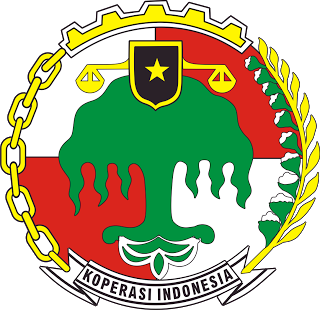

<div align="center">



# 🏛️ SPK Kelayakan Bantuan UMKM — Metode TOPSIS
### Sistem Pendukung Keputusan Berbasis Web (Studi Kasus: Koperasi Indonesia)

[](https://www.php.net/)
[](https://www.mysql.com/)
[](https://en.wikipedia.org/wiki/TOPSIS)
[](#lisensi--edukasi)
[](https://radevankaproject.com)

<p align="center">
  <strong>Aplikasi Sistem Pendukung Keputusan (SPK) Open-Source untuk Pembelajaran & Referensi Skripsi Mahasiswa</strong><br/>
  Dikembangkan dengan penuh dedikasi oleh <a href="https://radevankaproject.com"><strong>Radevanka Project</strong></a><br/>
  <em>"Build with Logic. Secure with Discipline. Deliver with Pride"</em>
</p>

---

[✨ Fitur Utama](#-fitur-utama) •
[📐 Metodologi TOPSIS](#-metodologi-topsis) •
[🗂️ Struktur Proyek](#️-struktur-proyek) •
[🚀 Cara Instalasi](#-cara-instalasi) •
[💼 Jasa Aplikasi Skripsi](#-butuh-bantuan-pembuatan-aplikasi-skripsi)

</div>

---

## 📖 Tentang Aplikasi

**SPK Kelayakan Bantuan UMKM** adalah aplikasi berbasis web yang dirancang khusus untuk membantu proses pengambilan keputusan secara objektif, transparan, dan terukur dalam menentukan prioritas penerima bantuan modal/usaha bagi pelaku **Usaha Mikro, Kecil, dan Menengah (UMKM)**.

Aplikasi ini mengimplementasikan metode **TOPSIS (*Technique for Order of Preference by Similarity to Ideal Solution*)** yang merupakan salah satu metode *Multi-Criteria Decision Making* (MCDM) paling populer untuk penelitian **Skripsi / Tugas Akhir Mahasiswa** jurusan Teknik Informatika, Sistem Informasi, maupun Ilmu Komputer.

Dirancang dengan identitas visual **Koperasi Indonesia** (*Hijau Beringin Tua, Kuning Emas Kerakyatan, dan Merah Putih*) serta tipografi **Roboto Slab**, aplikasi ini menyajikan antarmuka modern yang siap dipresentasikan pada sidang skripsi.

---

## ✨ Fitur Utama

### 1. 🧮 Perhitungan TOPSIS *Step-by-Step* & Transparan
Menampilkan seluruh tahapan matematis metode TOPSIS secara langsung di halaman hasil perhitungan:
- Tabel Kriteria, Bobot, dan Atribut (*Benefit* / *Cost*).
- **Tahap 1**: Matriks Keputusan Awal ($X$).
- **Tahap 2**: Matriks Normalisasi ($R$) beserta pembagi Euclidean.
- **Tahap 3**: Matriks Normalisasi Terbobot ($Y$).
- **Tahap 4**: Solusi Ideal Positif ($A^+$) dan Solusi Ideal Negatif ($A^-$).
- **Tahap 5**: Jarak Solusi Ideal Positif ($D_i^+$) dan Negatif ($D_i^-$).
- **Tahap 6**: Nilai Preferensi ($V_i$) dan **Peringkat Kelayakan Akhir**.

### 2. 🔐 Pembagian Hak Akses (*Role-Based Access Control*)
- **Administrator Koperasi (`Level 1`)**:
  - Akses penuh ke Dashboard Analitik, Manajemen Pengguna, Manajemen Kriteria & Bobot, Input/Edit Nilai Alternatif seluruh peserta UMKM, serta Perhitungan & Perangkingan TOPSIS.
- **Peserta / Pelaku UMKM (`Level 2`)**:
  - Akses terfokus dan aman khusus pada halaman **Input Nilai Usaha** (`/alternative/add`) untuk mengisi atau memperbarui profil nilai kriteria usahanya sendiri.

### 3. 📊 Dashboard Analitik & Visualisasi Data
- **KPI Summary Cards**: Ringkasan total peserta UMKM, jumlah kriteria penilaian, kandidat terbaik (#1), dan rata-rata skor preferensi.
- **Grafik Interaktif (Chart.js)**: Visualisasi perbandingan skor preferensi TOPSIS antar kandidat UMKM.
- **Tabel Peringkat Berbasis Medali**: Highlight otomatis untuk Peringkat 1 (Emas), Peringkat 2 (Perak), dan Peringkat 3 (Perunggu).
- **Export Laporan**: Dukungan ekspor tabel ke **Excel, PDF, CSV, Copy, dan Print** menggunakan DataTables.

### 4. 🎨 Antarmuka Koperasi Indonesia Modern
- Desain responsif dengan tema **Koperasi Indonesia**.
- **Custom Circular Progress Preloader**: Animasi progress bar melingkari logo Koperasi Indonesia (`0%–100%`).
- Notifikasi interaktif menggunakan **Toastr.js** dan proteksi keamanan form dengan **CSRF Token** + *Password Hashing* (`bcrypt`).

---

## 📐 Metodologi TOPSIS

Metode **TOPSIS** bekerja dengan prinsip bahwa alternatif terpilih harus memiliki **jarak terdekat dari solusi ideal positif ($A^+$)** dan **jarak terjauh dari solusi ideal negatif ($A^-$)**.

1. **Normalisasi Matriks Keputusan ($r_{ij}$)**
   $$r_{ij} = \frac{x_{ij}}{\sqrt{\sum_{i=1}^{m} x_{ij}^2}}$$

2. **Matriks Normalisasi Terbobot ($y_{ij}$)**
   $$y_{ij} = w_j \cdot r_{ij}$$

3. **Menentukan Solusi Ideal Positif ($A^+$) & Negatif ($A^-$)**
   - Untuk kriteria **Benefit**: $y_j^+ = \max(y_{ij})$ dan $y_j^- = \min(y_{ij})$
   - Untuk kriteria **Cost**: $y_j^+ = \min(y_{ij})$ dan $y_j^- = \max(y_{ij})$

4. **Menghitung Jarak Euclidean ($D_i^+$ dan $D_i^-$)**
   $$D_i^+ = \sqrt{\sum_{j=1}^{n} (y_j^+ - y_{ij})^2} \quad , \quad D_i^- = \sqrt{\sum_{j=1}^{n} (y_{ij} - y_j^-)^2}$$

5. **Menghitung Nilai Preferensi ($V_i$)**
   $$V_i = \frac{D_i^-}{D_i^- + D_i^+}$$
   *(Semakin mendekati `1.0000`, semakin tinggi prioritas kelayakan UMKM untuk menerima bantuan).*

---

## 🗂️ Struktur Proyek

```text
├── api/                        # Endpoint API internal & utilitas sistem
├── app/
│   ├── _template/              # Komponen layout (head, navbar, sidebar, footer, js)
│   ├── controllers/            # Logika bisnis & kalkulator TOPSIS
│   │   ├── AlternativeControllers.php
│   │   ├── CriteriasControllers.php
│   │   ├── TopsisCalculator.php
│   │   └── UsersControllers.php
│   └── views/                  # Antarmuka halaman (home, login, users, criteria, alternative, topsis)
├── assets/
│   ├── css/
│   │   ├── koperasi-theme.css  # Stylesheet utama tema Koperasi Indonesia
│   │   ├── pace.css            # Top progress bar
│   │   └── style.css           # Base layout stylesheet
│   ├── img/                    # Logo Koperasi & foto profil user
│   └── js/                     # Script tema & kustomisasi UI
├── config/
│   └── controlWeb.php          # Konfigurasi koneksi database, helper URL, CSRF & session
├── route/
│   └── web.php                 # Routing modul & proteksi Role-Based Access Control (RBAC)
├── .htaccess                   # Konfigurasi URL Rewrite untuk Apache (Laragon/XAMPP/cPanel)
├── nginx_rewrite.conf          # Konfigurasi URL Rewrite untuk Nginx (aaPanel/VPS)
├── index.php                   # Entry point utama aplikasi
└── kopf9761_topsis (1).sql     # File dump database SQL siap pakai
```

---

## 🚀 Cara Instalasi

### Prasyarat Sistem
- **PHP** versi `7.4` atau `8.x` (ekstensi `mysqli`, `gd`, `json` aktif)
- **MySQL** atau **MariaDB**
- Web Server: **Apache** (Laragon / XAMPP) atau **Nginx** (aaPanel / VPS)

### Langkah-Langkah Instalasi

1. **Clone / Unduh Repository**
   ```bash
   git clone https://github.com/radevankaproject/topsis-spk.git
   cd topsis-spk
   ```

2. **Buat Database & Import SQL**
   - Buat database baru di phpMyAdmin / MySQL dengan nama `sql_topsis` (atau sesuai keinginan).
   - Import file database `kopf9761_topsis.sql` ke dalam database tersebut.

3. **Konfigurasi Koneksi Database**
   Buka file [`config/controlWeb.php`](config/controlWeb.php) dan sesuaikan kredensial database Anda:
   ```php
   $srvName = "127.0.0.1";
   $dbUser  = "root";        // Sesuaikan user database Anda
   $dbPass  = "";            // Sesuaikan password database Anda
   $dbName  = "sql_topsis";  // Sesuaikan nama database Anda
   ```

4. **Konfigurasi Web Server (URL Rewrite)**
   - **Pengguna Apache (Laragon / XAMPP / cPanel)**:
     Pastikan `mod_rewrite` aktif dan sesuaikan baris `RewriteBase` di dalam file [`.htaccess`](.htaccess) (gunakan `RewriteBase /` jika menggunakan Virtual Host atau root domain).
   - **Pengguna Nginx (aaPanel / VPS)**:
     Salin konfigurasi yang ada di file [`nginx_rewrite.conf`](nginx_rewrite.conf) ke dalam menu **URL Rewrite** pada panel Nginx Anda.

5. **Jalankan Aplikasi**
   Akses URL aplikasi melalui browser (misal: `http://localhost/topsis-spk` atau domain Anda) dan login menggunakan akun Admin maupun akun Peserta UMKM yang tersedia di tabel `users`.

---

## 💼 Butuh Bantuan Pembuatan Aplikasi Skripsi?

Aplikasi ini di-*open-source*-kan secara gratis oleh **Radevanka Project** sebagai bentuk kontribusi untuk dunia pendidikan dan referensi pembelajaran mahasiswa di Indonesia.

Namun, jika Anda membutuhkan:
- 🚀 **Pembuatan Aplikasi Skripsi / Tugas Akhir Custom** (SPK Metode SAW, AHP, WP, TOPSIS, MOORA, ELECTRE, PROMETHEE, SMART, Profile Matching, Machine Learning, Sistem Informasi Geografis, E-Commerce, IoT, dll.)
- 🛠️ **Kustomisasi Fitur, Studi Kasus Baru, atau Revisi Sidang**
- 📱 **Aplikasi Berbasis Web (PHP Native, Laravel, CodeIgniter, Node.js, React) maupun Mobile (Flutter / Android)**

Jangan ragu untuk menghubungi tim kami! **Harga ramah kantong mahasiswa, mulai dari DI BAWAH 1 JUTA RUPIAH (< Rp1.000.000)!**

<div align="center">

### 🤝 Hubungi **Radevanka Project** Sekarang
> ***"Build with Logic. Secure with Discipline. Deliver with Pride"***

| Kanal Kontak | Informasi |
| :--- | :--- |
| 🏢 **Developer** | **Radevanka Project** |
| 🌐 **Website Resmi** | [**https://radevankaproject.com**](https://radevankaproject.com) |
| 📧 **Email** | [**hi@radevankaproject.com**](mailto:hi@radevankaproject.com) |
| 📸 **Instagram** | [**@radevankaproject**](https://instagram.com/radevankaproject) |
| 🎵 **TikTok** | [**@radevankaproject**](https://tiktok.com/@radevankaproject) |
| 📘 **Facebook** | [**@radevankaproject**](https://facebook.com/radevankaproject) |
| 🧵 **Threads** | [**@radevankaproject**](https://threads.net/@radevankaproject) |
| 💰 **Estimasi Biaya** | **Mulai dari di bawah Rp1.000.000** *(Konsultasi Gratis!)* |

</div>

---

## 📄 Lisensi & Edukasi

Source code proyek ini bersifat **Open Source** untuk keperluan **pembelajaran, riset akademik, dan referensi skripsi mahasiswa**. Silakan gunakan, pelajari, dan kembangkan lebih lanjut dengan tetap mencantumkan atribusi pengembang asli (**Radevanka Project**).

<div align="center">
  <sub>Dibuat dengan ❤️ oleh <a href="https://radevankaproject.com"><strong>Radevanka Project</strong></a> — <em>"Build with Logic. Secure with Discipline. Deliver with Pride"</em></sub>
</div>
